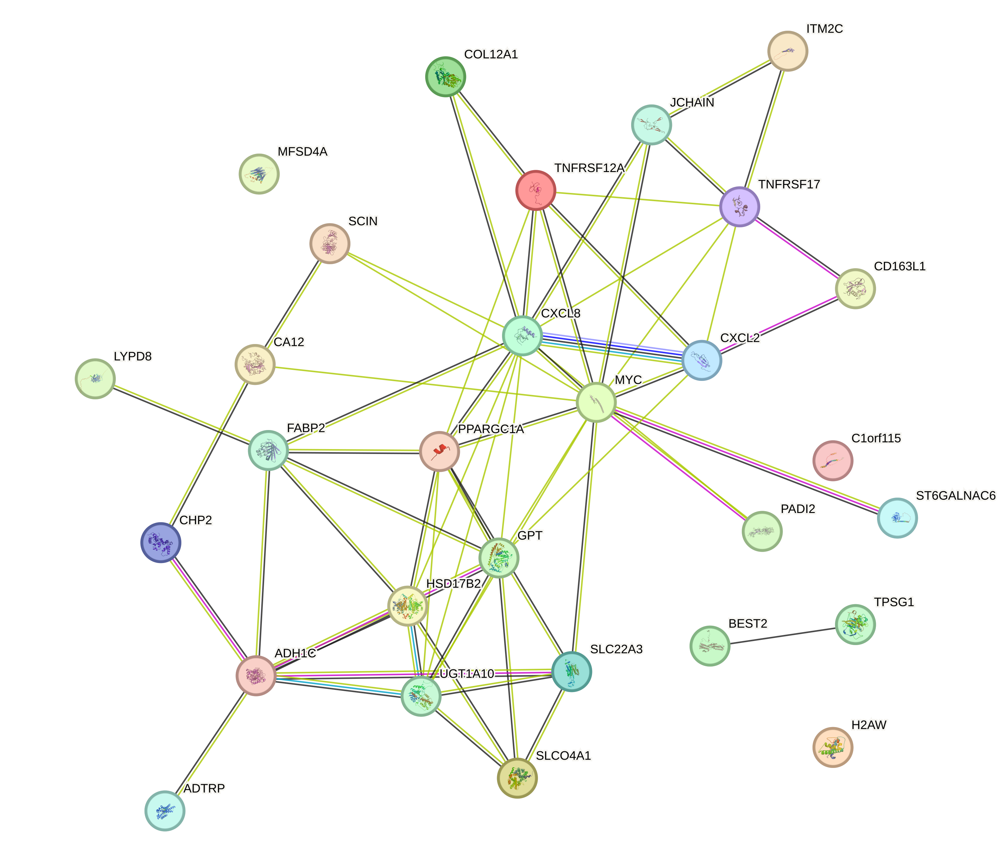
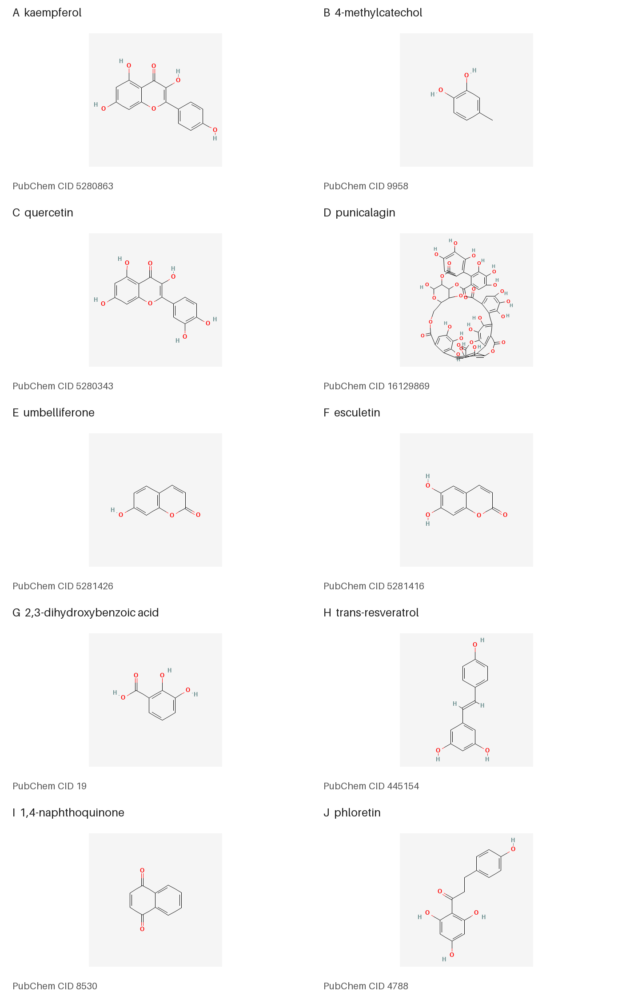
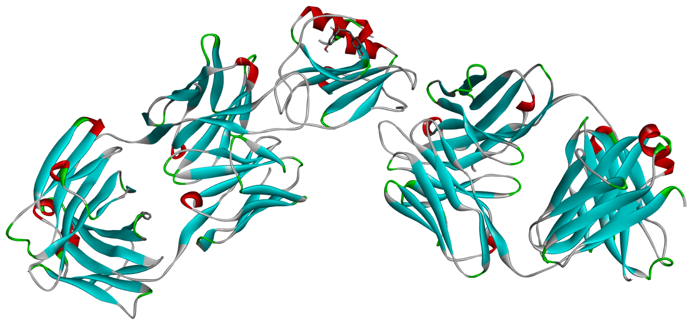
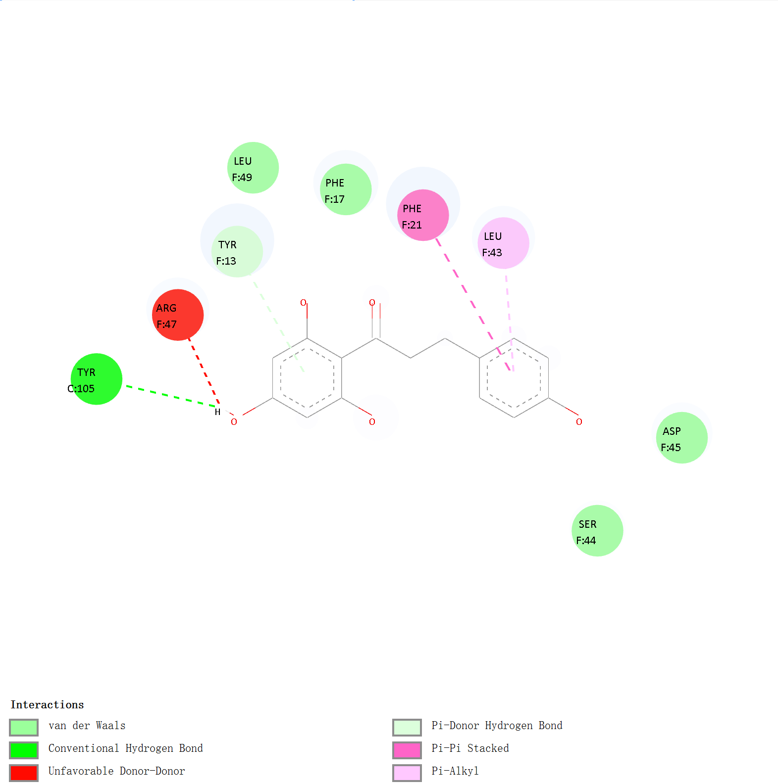
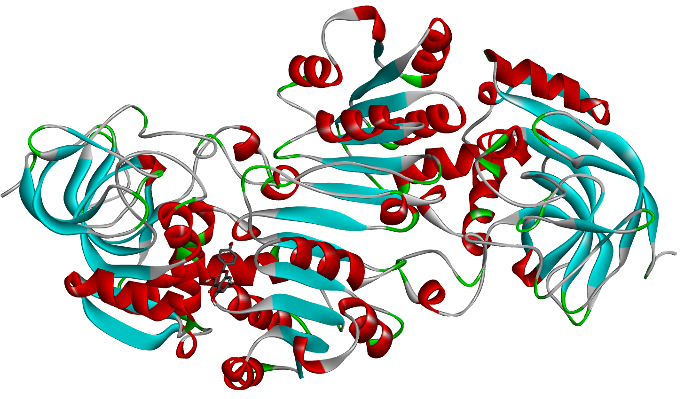
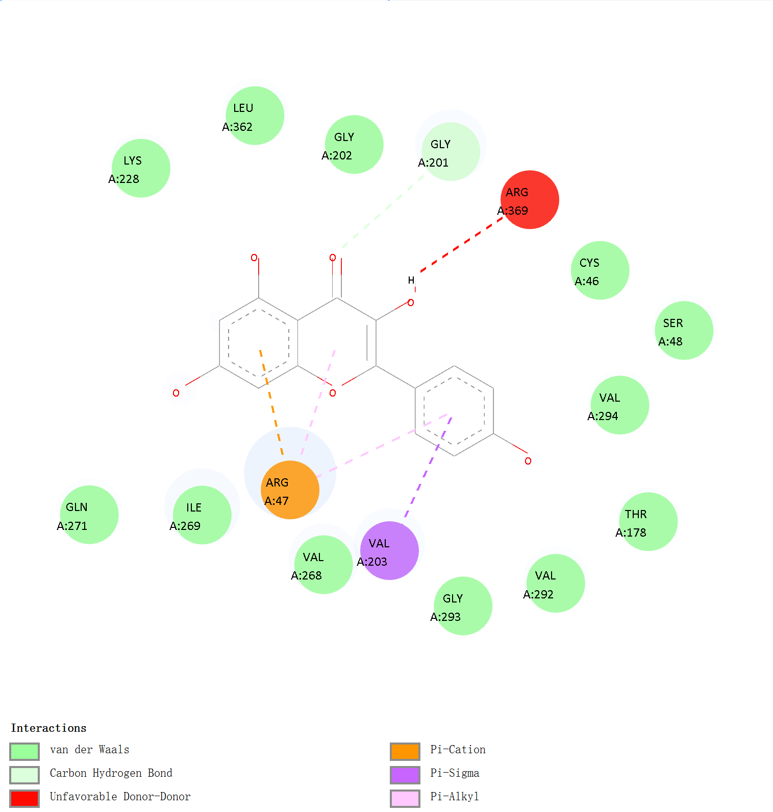

```{r setup, include=FALSE}
root <- Sys.getenv("RESEARCH_REPO_ROOT", unset = getwd())
root <- normalizePath(root, mustWork = TRUE)
knitr::opts_knit$set(root.dir = root)
knitr::opts_chunk$set(echo = TRUE, warning = FALSE, message = FALSE,
                      fig.align = "center", out.width = "100%", cache = FALSE,
                      fig.path = "figures/notebook/", dpi = 150, fig.retina = 1)
set.seed(20261104)
python <- Sys.getenv("PYTHON", unset = Sys.which("python3"))
if (!nzchar(python)) stop("Python 3 is required; set PYTHON to its executable.")
```

This study examines gene-expression changes across normal colorectal tissue, adenoma and early colorectal cancer, and uses the human interactome to prioritize polyphenols associated with progression-related proteins. The expression dataset is [GSE228012](https://www.ncbi.nlm.nih.gov/geo/query/acc.cgi?acc=GSE228012), with 33 samples and 11 samples per tissue group.

[Research files and README](https://github.com/hiuuuuu33/colorectal-polyphenol-research) | [Final manuscript](https://github.com/hiuuuuu33/colorectal-polyphenol-research/blob/main/manuscript/submitted-manuscript.pdf) | [R Markdown source](https://github.com/hiuuuuu33/colorectal-polyphenol-research/blob/main/Analysis.Rmd)

# Data and Analysis Setup {#analysis-setup}

The expression analysis uses log2(FPKM + 1), a three-group limma model, adjusted P < 0.05 and absolute log2 fold change > 1. The analysis modules write result tables and check them against the archived exports. Each figure section below executes its plotting code.

```{r analysis-setup}
library(ggplot2)
library(ggrepel)
library(patchwork)
source("scripts/R/01_transcriptomics.R")
source("scripts/R/02_enrichment_figures.R")
source("scripts/R/03_network.R")
source("scripts/R/04_docking.R")

transcriptomics <- run_transcriptomics(root)
expression_data <- readRDS("results/transcriptomics/transcriptomics_results.rds")
log2_fpkm <- expression_data$log2_fpkm
group <- expression_data$sample_info$group
de <- expression_data$de
prog <- expression_data$progressive
stage_colors <- c(Normal = "#00A087", Adenoma = "#E64B35", CRC = "#3C5488")
plot_theme <- theme_bw(base_size = 12) +
  theme(plot.title = element_text(face = "bold"), legend.title = element_blank())
```

# Figure 1: Transcriptomic Overview {#figure-1}

PCA uses unit-variance scaling. The three volcano plots show adenoma versus normal, carcinoma versus adenoma, and carcinoma versus normal.

```{r figure-1, fig.width=12, fig.height=9, fig.cap="Figure 1. PCA and differential-expression volcano plots."}
pca <- prcomp(t(log2_fpkm), center = TRUE, scale. = TRUE)
variance <- 100 * pca$sdev^2 / sum(pca$sdev^2)
pc <- data.frame(PC1 = pca$x[, 1], PC2 = pca$x[, 2], group = group)
pca_plot <- ggplot(pc, aes(PC1, PC2, color = group, shape = group)) +
  stat_ellipse(type = "norm", linewidth = 0.5, show.legend = FALSE) +
  geom_point(size = 3) + scale_color_manual(values = stage_colors) +
  labs(title = "PCA of GSE228012",
       x = sprintf("PC1 (%.1f%%)", variance[1]),
       y = sprintf("PC2 (%.1f%%)", variance[2])) + plot_theme

volcano_plots <- lapply(names(de), function(contrast) {
  dat <- de[[contrast]]
  dat$neg_log10_adjP <- -log10(pmax(dat$adj.P.Val, .Machine$double.xmin))
  upper <- dat[dat$direction == "Up", ]
  lower <- dat[dat$direction == "Down", ]
  labels <- rbind(head(upper[order(-upper$logFC), ], 5),
                  head(lower[order(lower$logFC), ], 5))
  ggplot(dat, aes(logFC, neg_log10_adjP)) +
    geom_point(aes(color = direction), alpha = 0.4, size = 1.2) +
    scale_color_manual(values = c(Up = "#DC0000", Down = "#3C5488", Stable = "grey70")) +
    geom_vline(xintercept = c(-1, 1), linetype = 4, color = "grey40", linewidth = 0.5) +
    geom_hline(yintercept = -log10(0.05), linetype = 4, color = "grey40", linewidth = 0.5) +
    geom_label_repel(data = labels, aes(label = gene), seed = 20261104,
                     color = "black", size = 2.8, max.overlaps = Inf, box.padding = 0.4) +
    labs(title = gsub("_", " ", contrast),
         x = "log2 fold change", y = "-log10 adjusted P") + plot_theme
})
figure1 <- wrap_plots(c(list(pca_plot), volcano_plots), ncol = 2) +
  plot_annotation(tag_levels = "A")
figure1
```

# Figure 2: Progression-Associated Genes {#figure-2}

The sequential contrasts identify 8 up/up and 21 down/down genes. The heatmap includes all 29 genes; the downregulated trajectory panel displays the 15 largest overall expression changes, matching the archived plotting selection.

```{r figure-2, fig.width=12, fig.height=9, fig.cap="Figure 2. A: 29-gene heatmap. B: 15 down/down trajectories. C: all eight up/up trajectories."}
stage_order <- order(group)
heat <- log2_fpkm[prog$gene, stage_order, drop = FALSE]
heat_z <- t(scale(t(heat)))
col_anno <- data.frame(Stage = group[stage_order], row.names = colnames(heat))
row_anno <- data.frame(Direction = prog$direction, row.names = prog$gene)
heatmap <- pheatmap::pheatmap(
  heat_z, silent = TRUE, cluster_cols = FALSE, cluster_rows = TRUE,
  show_colnames = FALSE, fontsize_row = 8, annotation_col = col_anno,
  annotation_row = row_anno,
  annotation_colors = list(Stage = stage_colors,
                            Direction = c("Up-Up" = "#DC0000", "Down-Down" = "#3C5488")),
  gaps_col = c(11, 22), main = "29 progression-associated genes"
)
means <- data.frame(
  gene = prog$gene, direction = prog$direction,
  Normal = rowMeans(log2_fpkm[prog$gene, group == "Normal", drop = FALSE]),
  Adenoma = rowMeans(log2_fpkm[prog$gene, group == "Adenoma", drop = FALSE]),
  CRC = rowMeans(log2_fpkm[prog$gene, group == "CRC", drop = FALSE])
)
long <- reshape(means, varying = c("Normal", "Adenoma", "CRC"), v.names = "Expression",
                 timevar = "Stage", times = c("Normal", "Adenoma", "CRC"), direction = "long")
long$Stage <- factor(long$Stage, levels = levels(group))
line_plot <- function(direction, color, title) {
  chosen <- prog[prog$direction == direction, ]
  chosen <- head(chosen[order(-abs(chosen$logFC_NC)), "gene"], 15)
  dat <- long[long$gene %in% chosen, ]
  ggplot(dat, aes(Stage, Expression, group = gene)) +
    geom_line(color = color, linewidth = 0.7, alpha = 0.8) +
    geom_point(color = color, size = 1.8) +
    geom_label_repel(data = dat[dat$Stage == "CRC", ], aes(label = gene),
                     seed = 20261104, direction = "y", nudge_x = 0.35,
                     max.overlaps = Inf, size = 2.6, color = color) +
    scale_x_discrete(expand = expansion(add = c(0.2, 1.2))) +
    labs(title = title, x = NULL, y = "Mean log2(FPKM + 1)") + plot_theme
}
down_plot <- line_plot("Down-Down", "#3C5488", "Progressively downregulated genes (top 15)")
up_plot <- line_plot("Up-Up", "#DC0000", "Progressively upregulated genes (all 8)")
figure2 <- wrap_plots(wrap_elements(full = heatmap$gtable), down_plot, up_plot,
                      design = "AB\nAC", widths = c(1.15, 1)) +
  plot_annotation(tag_levels = "A")
figure2
```

# Figure 3: Adenoma Versus Normal Enrichment {#figure-3}

GO and KEGG statistics come from the complete original result tables. The code filters adjusted P < 0.05 and draws up to 15 terms per panel.

```{r figure-3, fig.width=14, fig.height=15, fig.cap="Figure 3. Functional enrichment for adenoma versus normal tissue."}
enrichment <- run_enrichment_figures(root)
plot_enrichment <- function(contrast) {
  categories <- c("GO_BP", "GO_CC", "GO_MF", "KEGG_up", "KEGG_down")
  plots <- lapply(categories, function(category) {
    dat <- enrichment$results[[paste(contrast, category, sep = "__")]]
    significant <- dat[dat$p.adjust < 0.05, , drop = FALSE]
    shown <- head(significant[order(significant$p.adjust, significant$pvalue), ], 15)
    ratios <- strsplit(shown$GeneRatio, "/", fixed = TRUE)
    shown$GeneRatio_numeric <- vapply(ratios, function(x) as.numeric(x[1]) / as.numeric(x[2]), numeric(1))
    shown <- shown[order(shown$GeneRatio_numeric), ]
    shown$label <- vapply(shown$Description,
                          function(x) paste(strwrap(x, width = 42), collapse = "\n"), character(1))
    shown$label <- factor(shown$label, levels = unique(shown$label))
    ggplot(shown, aes(GeneRatio_numeric, label)) +
      geom_point(aes(size = Count, color = p.adjust)) +
      scale_color_gradient(low = "#CB2525", high = "#2866B0", name = "Adjusted P") +
      scale_size_continuous(range = c(3, 9), name = "Gene count") +
      labs(title = gsub("_", " ", category), subtitle = gsub("_", " ", contrast),
           x = "Gene ratio", y = NULL) +
      theme_bw(base_size = 11) +
      theme(plot.title = element_text(face = "bold"),
             axis.text.y = element_text(size = 9), panel.grid.minor = element_blank())
  })
  wrap_plots(plots, ncol = 2) + plot_annotation(tag_levels = "A")
}
plot_enrichment("Adenoma_vs_Normal")
```

# Figure 4: Carcinoma Versus Adenoma Enrichment {#figure-4}

The same function applies the same filtering and plotting rules to the carcinoma-versus-adenoma tables.

```{r figure-4, fig.width=14, fig.height=15, fig.cap="Figure 4. Functional enrichment for carcinoma versus adenoma."}
plot_enrichment("CRC_vs_Adenoma")
```

# Figure 5A: Progression-Associated Protein Network {#figure-5a}

The archived network contains 29 nodes and 61 edges. I display the original STRING export with its protein thumbnails and colored evidence channels. The Python analysis recomputes centrality and observed proximity distances from the archived inputs.

```{r figure-5a, fig.cap="Figure 5A. Original STRING protein network: 29 nodes and 61 edges."}
network_log <- system2(python, c("scripts/python/network_analysis.py", "--mode", "validate"),
                        stdout = TRUE, stderr = TRUE)
if (!is.null(attr(network_log, "status"))) stop(paste(network_log, collapse = "\n"))
nodes <- read.csv("results/network/ppi_centrality_recalculated.csv")
string_visual_log <- system2(python, c("scripts/build_string_visuals.py", "--offline"),
                              stdout = TRUE, stderr = TRUE)
if (!is.null(attr(string_visual_log, "status"))) stop(paste(string_visual_log, collapse = "\n"))

```

# Figure 5B: Protein Centrality {#figure-5b}

```{r figure-5b, fig.width=11, fig.height=5.2, fig.cap="Figure 5B. Degree, betweenness and closeness of the ten highest-degree proteins."}
top <- nodes[order(-nodes$degree, -nodes$betweenness, nodes$name), ][1:10, ]
metrics <- rbind(data.frame(name = top$name, metric = "Degree", value = top$degree),
                 data.frame(name = top$name, metric = "Betweenness", value = top$betweenness),
                 data.frame(name = top$name, metric = "Closeness", value = top$closeness))
metrics$name <- factor(metrics$name, levels = rev(top$name))
centrality <- ggplot(metrics, aes(value, name, fill = metric)) +
  geom_col(width = 0.7) + facet_wrap(~metric, scales = "free_x", nrow = 1) +
  scale_fill_manual(values = c(Betweenness = "#8A6792", Closeness = "#B49342", Degree = "#157D80")) +
  labs(title = "Topology of the ten highest-degree proteins", x = NULL, y = NULL) +
  theme_bw(base_size = 11) +
  theme(legend.position = "none", panel.grid.major.y = element_blank())
centrality
```

# Figure 6A: Network Proximity {#figure-6a}

Observed distances are recomputed using the archived mapping of 24 disease nodes. Historical random-distribution moments reproduce the saved Z scores. The original expression analysis retains all 29 progression-associated genes.

```{r figure-6a, fig.width=10, fig.height=4.6, fig.cap="Figure 6A. Closest-distance Z scores across 66 recorded compound entries."}
all_records <- read.csv("results/network/proximity_all_66_records.csv")
all_records <- all_records[order(all_records$z_closest), ]
all_records$record_rank <- seq_len(nrow(all_records))
distribution <- ggplot(all_records, aes(record_rank, z_closest)) +
  geom_hline(yintercept = c(-1.96, 1.96), color = "#B34C50", linetype = "dashed") +
  geom_point(aes(fill = z_closest), shape = 21, size = 3.2, color = "white", stroke = 0.4) +
  scale_fill_gradient2(low = "#157D80", mid = "#E5E8E6", high = "#B34C50", midpoint = 0) +
  labs(title = "Network proximity across 66 recorded entries",
       x = "Entry ordered by closest-distance Z score", y = expression(Z[closest])) +
  theme_bw(base_size = 11) + theme(legend.position = "none")
distribution
```

# Figure 6B: Prioritized Polyphenols {#figure-6b}

The 66 name entries represent 65 PubChem identities. Eleven unique identities pass Z < -1.96; the ten highest-ranked identities are shown here.

```{r figure-6b, fig.width=11, fig.height=6.5, fig.cap="Figure 6B. The ten highest-ranked compound identities."}
top10 <- read.csv("results/network/top10_candidates.csv")
top10$display_name <- factor(top10$display_name, levels = rev(top10$display_name))
lollipop <- ggplot(top10, aes(-z_closest, display_name)) +
  geom_segment(aes(xend = 0, yend = display_name), linewidth = 0.9, color = "#B7C4C3") +
  geom_point(aes(size = n_mapped_chemical, fill = -z_closest),
              shape = 21, color = "white", stroke = 0.8) +
  geom_text(aes(label = sprintf("%.2f", z_closest)), nudge_x = 0.2, hjust = 0, size = 3.5) +
  scale_size_continuous(range = c(3.5, 10), name = "Mapped targets",
                        guide = guide_legend(override.aes = list(fill = "#157D80", color = "#157D80"))) +
  scale_fill_gradient(low = "#B9DAD5", high = "#157D80", name = expression(-Z[closest])) +
  scale_x_continuous(expand = expansion(mult = c(0.02, 0.22))) +
  labs(title = "Ten prioritized compound identities", x = expression(-Z[closest]), y = NULL) +
  theme_bw(base_size = 11) + theme(panel.grid.major.y = element_blank())
lollipop
```

# Figure 7: Chemical Structures {#figure-7}

The Python script assembles the cached PubChem depictions by compound identifier. [Structure assembly source](https://github.com/hiuuuuu33/colorectal-polyphenol-research/blob/main/scripts/build_chemical_structures.py).

```{r figure-7, fig.cap="Figure 7. Cached PubChem structures for the ten prioritized compounds."}
candidates <- read.csv("results/network/top10_candidates.csv")
structure_files <- file.path("data/chemistry/pubchem", paste0("CID_", candidates$pubchem_cid, ".png"))
stopifnot(all(file.exists(structure_files)))
chemistry_log <- system2(python, "scripts/build_chemical_structures.py", stdout = TRUE, stderr = TRUE)
if (!is.null(attr(chemistry_log, "status"))) stop(paste(chemistry_log, collapse = "\n"))

```

# Figure 8: Compound-Associated Target Networks {#figure-8}

The target networks use cached human STRING v12.0 functional associations with a combined score cutoff of 0.400 and no added neighbors. I display each network separately using its native STRING image. The images and request parameters are cached for offline use.

```{r figure-8, fig.cap=paste0("Figure 8. ", compound_info$display_name, ": native STRING target network.")}
string_log <- system2(python, c("scripts/python/fetch_string_compounds.py", "--offline"),
                       stdout = TRUE, stderr = TRUE)
if (!is.null(attr(string_log, "status"))) stop(paste(string_log, collapse = "\n"))
compound_info <- read.csv("results/network/compound_string_summary.csv")
compound_images <- file.path("figures/reproduced/network/string_native",
                              paste0(gsub("[^[:alnum:]]", "", compound_info$chemical), "_preview.png"))
stopifnot(all(file.exists(compound_images)))
knitr::include_graphics(compound_images)
```

# Table 5: Docking Scores {#table-5}

The workbook contains 10 primary compounds and one supplementary punicalagin structure, each evaluated against ADH1C (1HT0) and the CXCL8-Fab receptor system (6WZM).

```{r table-5}
docking <- run_docking(root)
knitr::kable(docking$scores[, c("compound", "pubchem_cid", "record_type", "ADH1C_1HT0", "CXCL8_Fab_6WZM")],
             col.names = c("Compound", "PubChem CID", "Record type", "ADH1C (1HT0)", "CXCL8-Fab (6WZM)"),
             digits = 1, caption = "Table 5. Archived best-mode Vina scores in kcal/mol.")
```

## Docking Score Plot {#docking-score-plot}

```{r docking-score-plot, fig.width=11.5, fig.height=7.5, fig.cap="Docking scores reconstructed from the original workbook."}
records <- docking$scores
score_data <- rbind(
  data.frame(records, receptor = "ADH1C / 1HT0", score = records$ADH1C_1HT0),
  data.frame(records, receptor = "CXCL8-Fab assembly / 6WZM", score = records$CXCL8_Fab_6WZM)
)
score_data$compound <- factor(score_data$compound, levels = rev(records$compound))
score_data$receptor <- factor(score_data$receptor,
                               levels = c("ADH1C / 1HT0", "CXCL8-Fab assembly / 6WZM"))
score_plot <- ggplot(score_data, aes(score, compound)) +
  geom_vline(xintercept = 0, color = "grey75", linewidth = 0.4) +
  geom_segment(aes(x = 0, xend = score, yend = compound), color = "grey80", linewidth = 0.6) +
  geom_point(aes(color = receptor, shape = record_type), size = 3) +
  geom_text(aes(label = sprintf("%.1f", score)), nudge_y = 0.25, size = 3, show.legend = FALSE) +
  facet_grid(. ~ receptor) +
  scale_color_manual(values = c("#087F8C", "#B74065"), guide = "none") +
  scale_shape_manual(values = c(primary = 16, supplementary_structure = 17),
                      labels = c("Primary compound record", "Supplementary punicalagin structure"), name = NULL) +
  scale_x_continuous(limits = c(-9, 2.5), breaks = seq(-8, 2, 2)) +
  labs(title = "Archived molecular-docking scores",
       x = "Best-mode AutoDock Vina score (kcal/mol)", y = NULL) +
  theme_bw(base_size = 11) +
  theme(panel.grid.major.y = element_blank(), panel.grid.minor = element_blank(),
         legend.position = "bottom", plot.margin = margin(10, 12, 10, 10))
score_plot
```

# Figure 9: Original Docking Images {#figure-9}

I use the four original PNG panels embedded in my docking presentation. They show phloretin in the 6WZM receptor system and kaempferol in 1HT0, matching the four panels of submitted Figure 9. Each image is extracted without redrawing, cropping or rescaling its stored pixels.

```{r figure-9a, fig.cap="Figure 9A. Original three-dimensional phloretin / 6WZM image."}
panel_log <- system2(python, "scripts/extract_docking_panels.py", stdout = TRUE, stderr = TRUE)
if (!is.null(attr(panel_log, "status"))) stop(paste(panel_log, collapse = "\n"))

```

```{r figure-9b, fig.cap="Figure 9B. Original two-dimensional phloretin interaction map."}

```

```{r figure-9c, fig.cap="Figure 9C. Original three-dimensional kaempferol / 1HT0 image."}

```

```{r figure-9d, fig.cap="Figure 9D. Original two-dimensional kaempferol interaction map."}

```

# Result Tables and Verification {#verification}

```{r verification}
knitr::kable(transcriptomics$summary, caption = "Differential-expression summary")
progressive_display <- prog
p_columns <- grep("^adjP", names(progressive_display), value = TRUE)
progressive_display[p_columns] <- lapply(progressive_display[p_columns],
                                        format, scientific = TRUE, digits = 3)
knitr::kable(progressive_display, digits = 4, caption = "All 29 progression-associated genes")
knitr::kable(read.csv("results/transcriptomics/verification.csv"), caption = "Expression verification")
knitr::kable(read.csv("results/enrichment/verification.csv"), caption = "Enrichment table verification")
knitr::kable(docking$grids, caption = "Archived docking search-space parameters")
```

The original research files, frozen enrichment results, historical randomization moments and submitted pose illustrations are documented in the [provenance record](https://github.com/hiuuuuu33/colorectal-polyphenol-research/blob/main/docs/provenance.md). Fresh seeded network randomization is available through `scripts/python/network_analysis.py --mode randomize --n-random 1000`.

# Software Environment {#software-environment}

```{r software-environment}
sessionInfo()
```
